# SeatLock

**An event-ticketing app where two people can never book the same seat, shipped through a
production-style DevOps platform:** tested and security-scanned in GitHub Actions, packaged
as SHA-tagged images in GHCR, provisioned on AWS EKS with Terraform, deployed by Argo CD
through GitOps, and observed with Prometheus, Grafana and Loki.

[](https://github.com/sanaa-duhh/Seatlock_Devops/actions/workflows/ci.yml)

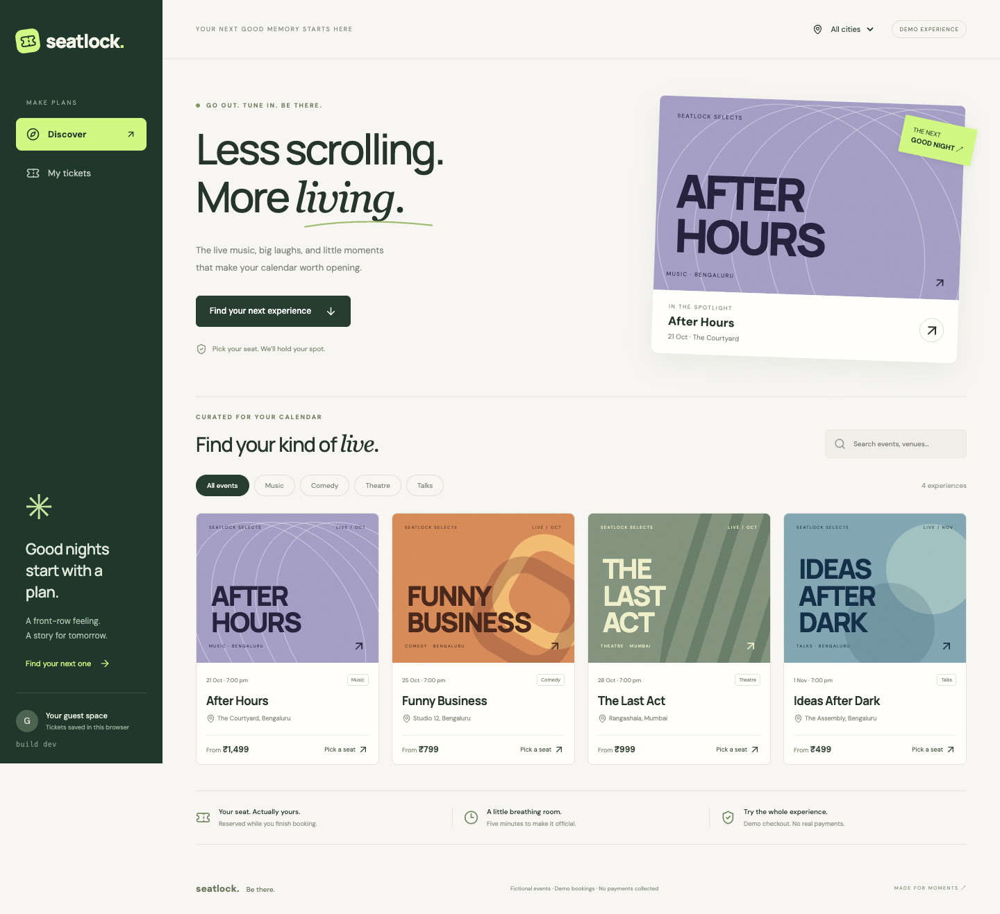

## Highlights

- **Correct under concurrency.** Seat holds use ordered PostgreSQL row locks inside one
  transaction, so competing buyers on different API replicas cannot double-book. The test
  suite runs real competing transactions to prove it.
- **Thirteen pipeline gates.** Lint, format, pytest (88% coverage), Bandit, pip-audit,
  npm audit, Gitleaks over the full history, Terraform validate, Helm lint, Trivy IaC scan,
  a Trivy image scan of both images, Playwright on Docker Compose, and Playwright again on
  a throwaway kind cluster. All of them must pass before anything is published.
- **Build once, deploy the same bytes.** Each image is built once, tagged with the commit
  SHA, scanned, tested in Kubernetes, then pushed to GHCR and deployed. Every running Pod
  traces back to the commit it came from, and the UI shows that commit.
- **GitOps with Argo CD.** CI never deploys and holds no cloud credentials. It commits the
  new image tag to Git; Argo CD in the cluster pulls the change, syncs it in order
  (database, then migrations, then the app) and reverts manual drift. Rollback is a
  `git revert`.
- **Hardened runtime.** Non-root containers, read-only root filesystems, all capabilities
  dropped, and startup, liveness and readiness probes with distinct meanings.
- **Real findings, fixed.** Scanning found 46 HIGH CVEs in the original backend image and a
  libtiff CVE hidden by a stale build cache. Both were fixed without suppressions; see
  [security/README.md](security/README.md).
- **Operability.** HPA scaling 2→4 under load, a Grafana dashboard of request rate, p95
  latency, errors and seat conflicts, request-ID logs in Loki, and fault-injection drills
  with recorded recoveries.

## What it looks like

<p align="center">
  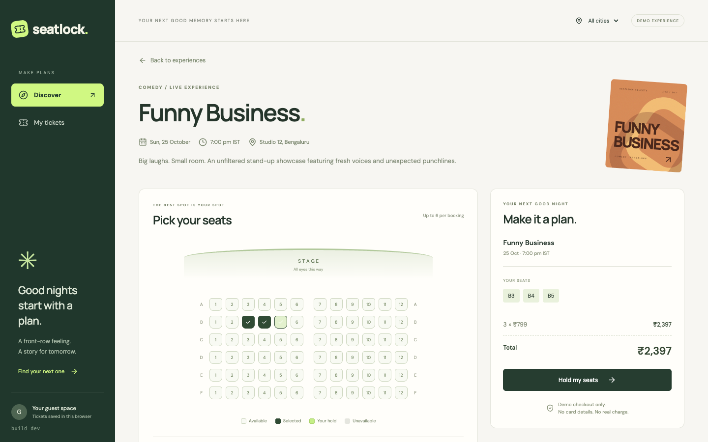
  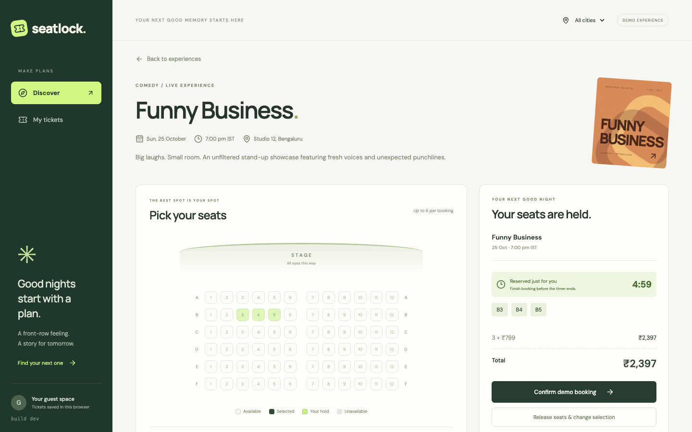
</p>
<p align="center"><sub>Pick up to six seats, then they're held for five minutes with a live countdown.</sub></p>

<p align="center">
  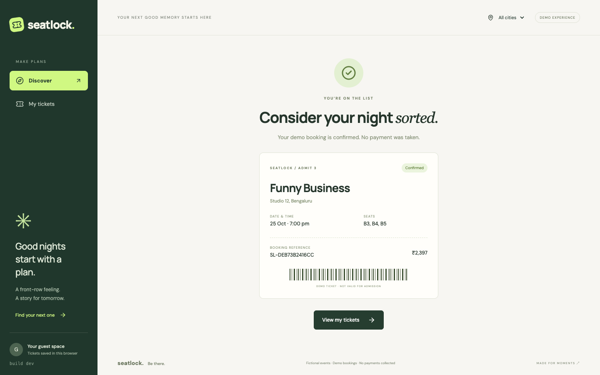
  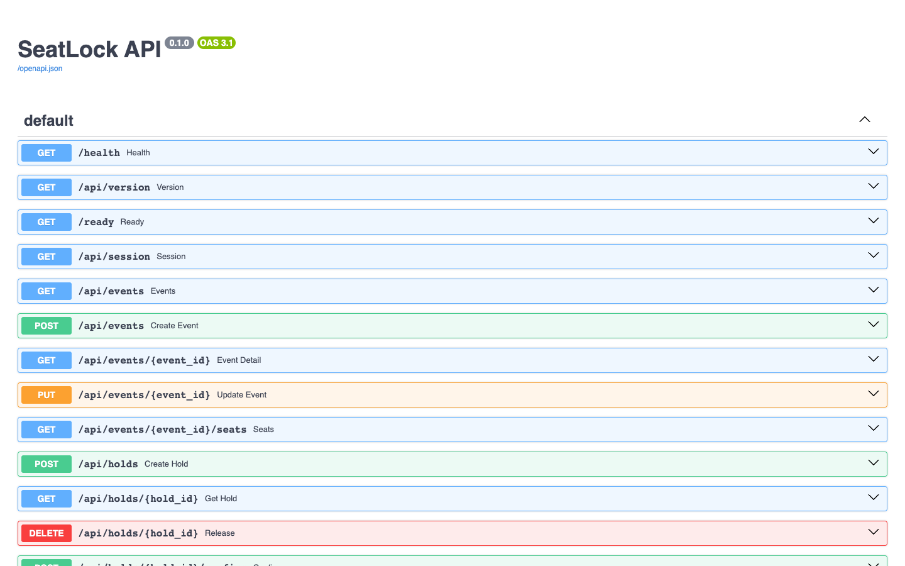
</p>
<p align="center"><sub>A confirmed ticket, and the REST API documented in Swagger at <code>/docs</code>.</sub></p>

## Architecture

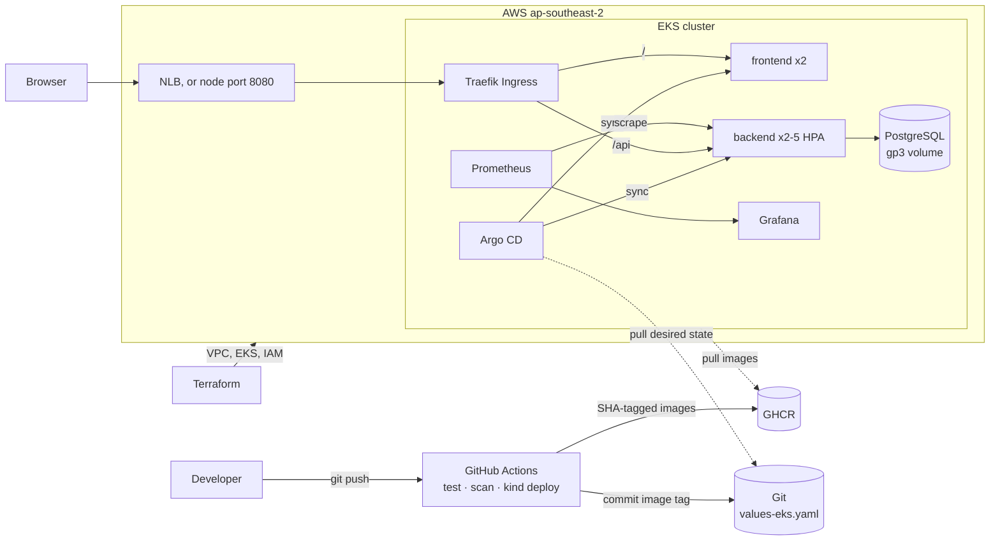

Design decisions and the booking state machine are in
[docs/ARCHITECTURE.md](docs/ARCHITECTURE.md).

## Tech stack

| Area | Tools |
|---|---|
| Frontend | React 19, TypeScript, Vite, served by unprivileged Nginx |
| Backend | FastAPI, SQLAlchemy 2, Alembic, PostgreSQL 15, prometheus-client |
| Testing | Pytest (real PostgreSQL), Playwright (desktop + mobile) |
| Containers | Docker multi-stage builds, Docker Compose |
| CI/CD | GitHub Actions, GHCR, Dependabot |
| Security | Trivy (images + IaC), Gitleaks, Bandit, pip-audit, npm audit |
| Infrastructure | Terraform (terraform-aws-modules VPC + EKS), AWS EKS, EBS CSI, EKS Pod Identity |
| Kubernetes | Helm, Argo CD (GitOps), Traefik Ingress, HPA + metrics-server, StatefulSet + PVC |
| Observability | kube-prometheus-stack (Prometheus, Grafana, Alertmanager), Loki, Grafana Alloy |

## Repository layout

```text
backend/            FastAPI app, Alembic migrations, pytest suite, Dockerfile
frontend/           React app, Playwright tests, Nginx config, Dockerfile
docker-compose.yml  Local stack: postgres → migrate → backend → frontend
.github/workflows/  CI/CD pipeline
terraform/          AWS VPC, EKS, node group, add-ons
gitops/             Argo CD AppProject and Application
k8s/                Namespace, EKS StorageClass, Traefik and Argo CD values
helm/seatlock/      Application chart (values.yaml local, values-eks.yaml cloud)
monitoring/         Prometheus/Grafana values, dashboards, alerts, Loki/Alloy
troubleshooting/    Deliberately broken manifests with diagnosis guides
scripts/            EKS bootstrap/teardown, load, drills, backup/restore
security/           Gate policy, findings and scan reports
docs/               Architecture, drill records, screenshots
demo/               Presentation slides (PPTX, PDF) and the demo video
```

## Quick start (local)

Requirements: Docker with Compose, Python 3.11, Node 24, `make`.

```bash
make up          # generates a private .env, builds and starts all services
```

| URL | What |
|---|---|
| http://localhost:3000 | SeatLock UI |
| http://localhost:8000/docs | Swagger UI for the API |
| http://localhost:8000/health, `/ready`, `/metrics` | liveness, readiness, Prometheus metrics |

`make monitoring` adds Prometheus (http://localhost:9090) and Grafana
(http://localhost:3002, user `admin`, password = `ADMIN_TOKEN` in `.env`).
`make down` stops everything and keeps the data; `docker compose down -v` also deletes it.
Run `make help` for every shortcut.

### API

| Method | Path | Purpose |
|---|---|---|
| GET | `/api/events`, `/api/events/{id}`, `/api/events/{id}/seats` | Browse events and live seat availability |
| POST | `/api/holds` | Hold up to six seats for five minutes (all-or-nothing) |
| GET | `/api/holds/{id}` | Hold status and countdown |
| POST | `/api/holds/{id}/confirm` | Confirm a booking (retry-safe) |
| DELETE | `/api/holds/{id}` | Release a hold |
| GET | `/api/bookings` | The current guest's tickets |
| POST | `/api/bookings/{id}/cancel` | Cancel a booking |
| POST / PUT | `/api/events`, `/api/events/{id}` | Organizer create and update (admin token) |
| GET | `/health`, `/ready`, `/metrics` | Probes and metrics |

## Testing

```bash
make test        # 29 pytest tests against a throwaway PostgreSQL, 88% coverage
make lint        # ruff, bandit, prettier, terraform fmt, helm lint
make e2e         # Playwright booking journey on desktop and mobile (stack must be up)
make scan        # Trivy image + IaC scan, same policy as CI
```

The pytest fixtures refuse to run against anything except the dedicated test database,
so the demo data can never be truncated by a test run.

## CI/CD pipeline

[`.github/workflows/ci.yml`](.github/workflows/ci.yml) runs on every pull request and every
push to `main`:

```text
backend tests + SAST ─┐
frontend build ───────┼─► build + Trivy-scan images (:SHA) ─┐
IaC + secret scan ────┘                                     ├─► Helm on kind + Playwright ─► push to GHCR ─► commit tag ─► verify rollout
                         Playwright on Docker Compose ──────┘                                 (main only)     (main only)    (main only)
```

- A failing test or a HIGH/CRITICAL vulnerability stops the pipeline before anything is
  pushed.
- Images are tagged only with the full commit SHA, for example
  `ghcr.io/sanaa-duhh/seatlock-backend:<sha>`.
- The `gitops` job rewrites both image tags in `helm/seatlock/values-eks.yaml` and commits
  them (`[skip ci]`). Argo CD notices within a minute and rolls the new Pods out.
- The `verify` job polls the public `/api/version` endpoint until it reports this commit,
  so the run only goes green once the new version is actually serving. It skips itself
  when no cluster exists.
- Actions are pinned to commit SHAs; scanner images are pinned by digest.

## Kubernetes and Helm

The chart in [`helm/seatlock`](helm/seatlock) deploys:

- frontend and backend Deployments with 2 replicas each (the backend autoscales 2→5 on
  CPU through an HPA)
- ClusterIP Services for both
- an Ingress routing `/` to the frontend and `/api` to the backend
- PostgreSQL as a StatefulSet with a persistent volume
- a migration Job per release
- a ConfigMap, and Secret references
- a ServiceMonitor and alert rules

**Local (minikube):**

```bash
minikube start --cpus=4 --memory=6000 && minikube addons enable metrics-server
make k8s-local                      # builds, loads images, installs the chart
bash scripts/local-platform.sh      # optional: Traefik, Prometheus/Grafana, Loki/Alloy
kubectl -n seatlock get pods,svc,hpa,ingress
```

## AWS: Terraform, EKS and GitOps

```bash
cp terraform/terraform.tfvars.example terraform/terraform.tfvars
make tf-plan       # terraform init + plan
make eks-up        # apply (~15 min), then scripts/eks-bootstrap.sh
make eks-down      # delete Argo CD apps, LB and volumes, terraform destroy, check for leftovers
```

Terraform creates:

- a VPC with two public and two private subnets across two AZs
- an EKS 1.37 cluster with a managed node group (2 × t3.medium)
- the CoreDNS, kube-proxy, VPC CNI, metrics-server and Pod Identity add-ons
- the EBS CSI driver, which gets its AWS permissions through EKS Pod Identity
- a KMS key that encrypts Kubernetes Secrets

`eks-bootstrap.sh` installs Traefik, kube-prometheus-stack, Loki and Argo CD, creates the app
Secret, and applies [`gitops/application.yaml`](gitops/application.yaml). From then on Argo CD
deploys whatever `helm/seatlock/values-eks.yaml` on `main` says, and every pipeline run on
`main` updates that file.

**Argo CD:**

- The **AppProject** limits it to this one repository and the `seatlock` namespace.
- The **Application** has automated sync, prune and self-heal turned on.
- Sync waves order a rollout: database first, then the migration Job (a sync hook), then
  the app.
- The UI is at `kubectl -n argocd port-forward svc/argocd-server 8080:80`.

`ingress_mode` adapts the same code to what an AWS account allows:

| Mode | Layout | Approx. cost in Sydney |
|---|---|---|
| `nlb` (default) | private nodes, NAT gateway, Traefik behind an AWS Network Load Balancer | about $0.31/h |
| `hostport` | nodes in public subnets, Traefik on port 8080 of each node, no NAT or LB | about $0.22/h |

`make eks-down` deletes the Argo CD Application (and with it everything it deployed), any
Kubernetes-created load balancer and the EBS volumes *before* `terraform destroy`, so the
VPC deletion does not stall and no orphaned disks keep billing. It then lists leftover
clusters, volumes, load balancers, NAT gateways and Elastic IPs, which should all be empty.

## Monitoring

- The backend exports `seatlock_http_requests_total`, `seatlock_http_duration_seconds`,
  `seatlock_seat_conflicts_total` and `seatlock_bookings_confirmed_total`.
- A ServiceMonitor makes Prometheus scrape every backend replica.
- The **SeatLock: Booking Reliability** Grafana dashboard shows request rate, p95 latency,
  5xx rate, seat conflicts, confirmations and scrape availability.
- Alerts fire when the API is unreachable or returning server errors.
- Alloy ships JSON request logs to Loki; each log line carries the request ID that the API
  also returns in the `X-Request-ID` header.

```bash
kubectl -n seatlock-monitoring port-forward svc/monitoring-grafana 3006:80
python3 scripts/load.py --url http://<app-host>/api/events/1/seats --seconds 120 --workers 16   # watch: kubectl -n seatlock get hpa -w
```

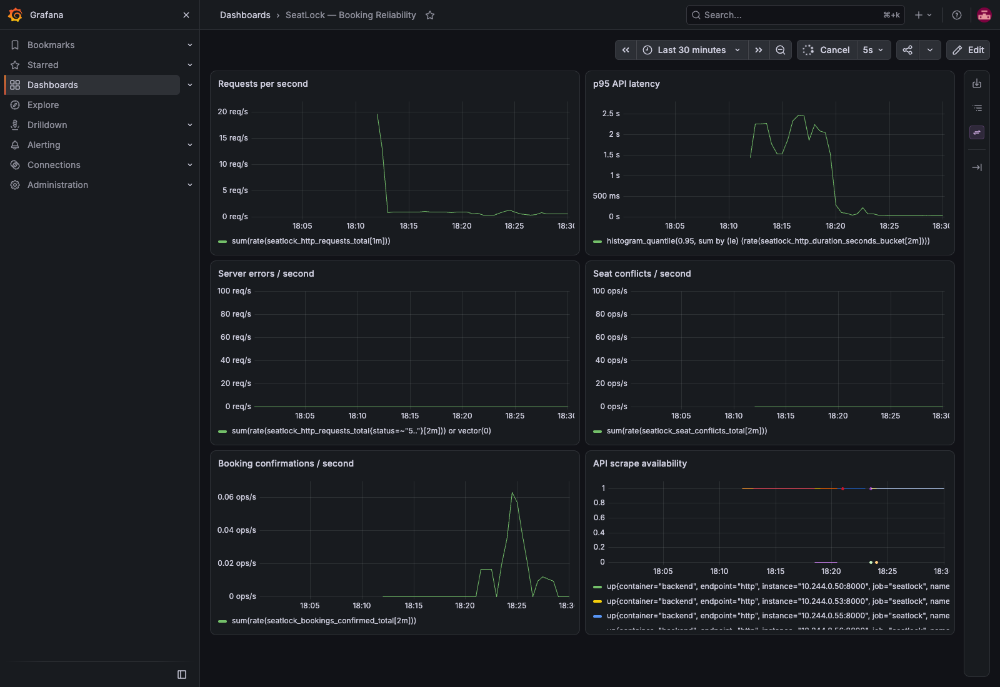

## Troubleshooting

- [`troubleshooting/`](troubleshooting/README.md) has four broken manifests to diagnose by
  hand, each with symptoms, commands and the fix:
  - ImagePullBackOff
  - a Service with no endpoints
  - a failing readiness probe
  - a missing Secret key
- `scripts/drill.sh run-all` injects faults into a full SeatLock release, captures the
  evidence, restores it and re-verifies a booking. The recorded runs, including a combined
  three-fault incident, are in [docs/TROUBLESHOOTING.md](docs/TROUBLESHOOTING.md).

## Lessons learned

- **Locks belong in the database.** A client-side countdown cannot stop two replicas
  selling one seat. Ordered row locks and rechecking expiry *after* acquiring them can.
- **A dependency audit is not an image scan.** pip-audit was clean while the image carried
  44 vulnerable OS packages and old build tools. Switching to an Alpine base and removing
  pip/wheel from the runtime fixed it.
- **A cached image can be a stale image.** A clean scan of a cached `apk upgrade` layer hid
  a libtiff CVE that a fresh build fixed. Security scans should run on fresh builds.
- **Read-only root filesystems need testing.** Turning them on broke nothing in the
  manifests' YAML but would have broken nginx and Postgres without the right scratch mounts.
  Redeploying and re-running the browser tests is what proved the change safe.
- **Terraform doesn't know what Kubernetes created.** Load balancers and volumes made by the
  cluster must be removed before `terraform destroy`, or teardown stalls and keeps billing.
- **Every AWS account has its own guardrails.** The demo account's organization allowed one
  region, denied IAM OIDC providers, and had load balancers disabled. Free probes found each
  limit before anything was created: `--dry-run` calls, and deliberately invalid requests
  whose error type shows whether the policy allows the action. The infrastructure was made
  switchable (`ingress_mode`, region, Pod Identity instead of IRSA) instead of being
  rewritten for one account.
- **Test the real network path.** nginx's resolver ignores DNS search domains, so the
  short name `backend` worked in Docker Compose but not inside Kubernetes. Only the CI job
  that installs the chart on a kind cluster caught it.
- **Managed add-ons have their own requirements.** The first EKS run surfaced four issues that
  no local cluster shows:
  - The Pod Identity agent declares host port 80, so Traefik moved to 8080.
  - The metrics-server add-on serves on 10251, which the default node security group
    blocks, so the HPA had no CPU data until one rule was added.
  - A host-port DaemonSet deadlocks on a surge rollout, so it needs `maxSurge: 0`.
  - A t3.medium fits only 17 Pods, so the first scale-up stayed Pending until a third node
    joined.

  Each fix is in code, and the run's evidence shows the result.
- **Advertised capacity isn't real capacity.** minikube reported more memory than its Docker
  container actually had, which showed up as Grafana probe failures until the limits were
  measured and raised.

## Evidence from the EKS run

Captured on 14 October 2026 from the real cluster in `ap-southeast-2`, then torn down.
Raw command output is in [`docs/evidence/eks/`](docs/evidence/eks/).

<p align="center">
  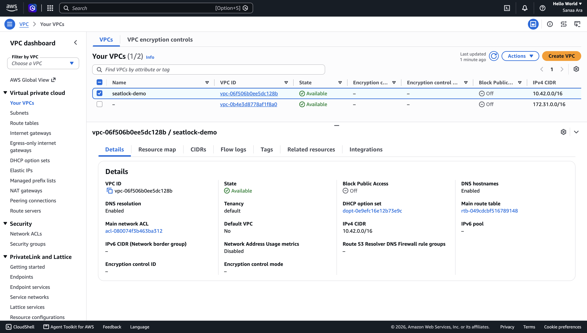
  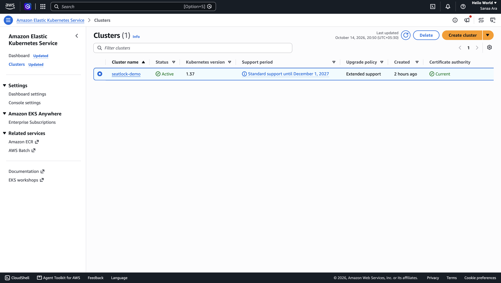
</p>
<p align="center"><sub>AWS Console: the Terraform-created VPC and the EKS 1.37 cluster.</sub></p>

<p align="center">
  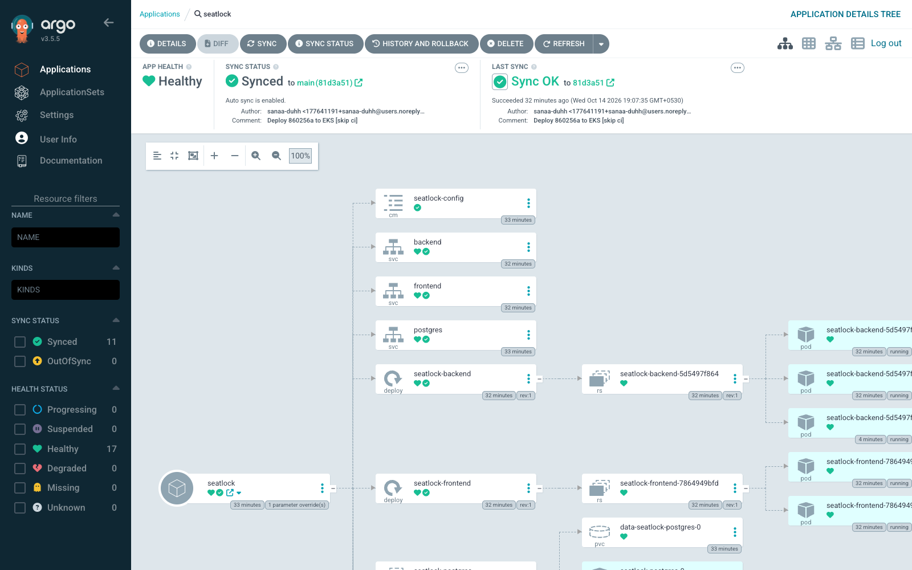
  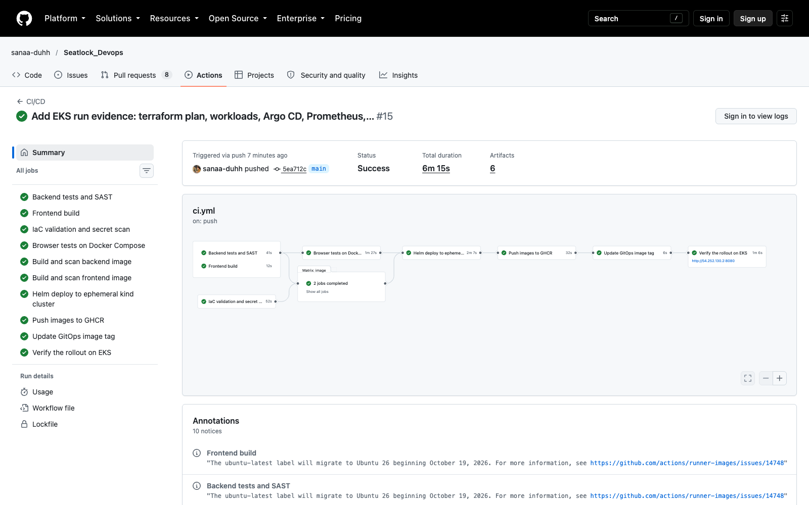
</p>
<p align="center"><sub>Argo CD synced and healthy from Git, and a green pipeline that ends by verifying the new version is live on EKS.</sub></p>

<p align="center">
  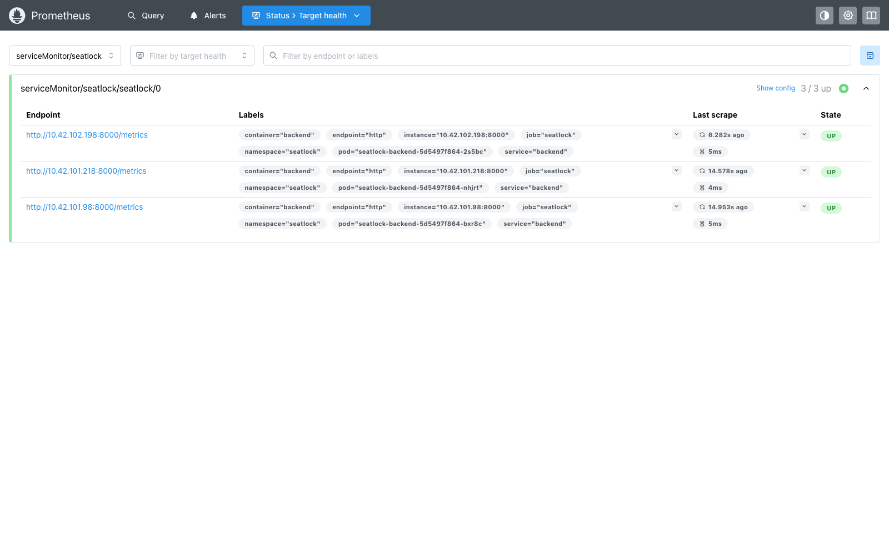
  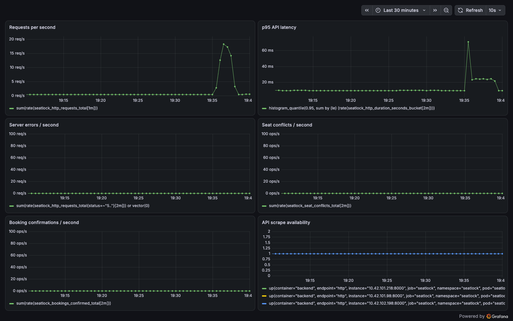
</p>
<p align="center"><sub>Prometheus scraping all three backend Pods, and Grafana during a load test that scaled the HPA from 2 to 3 Pods.</sub></p>

| Check | Evidence |
|---|---|
| `terraform plan` (60 resources) | [screenshot](docs/screenshots/eks/terraform-plan.png) · [full output](docs/evidence/terraform-plan.txt) |
| Nodes, Pods, Services, Ingress, PVC | [nodes](docs/screenshots/eks/nodes.png) · [workloads](docs/screenshots/eks/workloads.png) |
| `helm list` and the Argo CD application | [helm](docs/screenshots/eks/helm-list.png) · [argocd](docs/screenshots/eks/argocd-app.png) |
| HPA scale-up event | [hpa](docs/screenshots/eks/hpa.png) |
| `/metrics` endpoint | [metrics](docs/screenshots/eks/metrics-endpoint.png) |
| Images in GHCR with commit-SHA tags | [package page](docs/screenshots/ci/ghcr-backend-package.png) |
| App served through the Ingress on EKS | [app](docs/screenshots/eks/app-on-eks.png) |
| `terraform destroy` and leftover check | [teardown](docs/screenshots/eks/terraform-destroy.png) |

## Known issues and limitations

- **Demo scope.** Guest sessions instead of user accounts; checkout is simulated and takes
  no payment; no emails or ticket transfers.
- **Single PostgreSQL instance** in the cluster. A restart of its Pod is a short outage;
  production would use Amazon RDS Multi-AZ with automated backups.
- **Plain HTTP.** The app is served over HTTP on the load balancer hostname or node IP.
  TLS needs a domain and a certificate (ACM or cert-manager); session cookies switch to
  `Secure` once it is enabled.
- **Secrets** are created from a local, git-ignored file by the bootstrap script.
  Production would use AWS Secrets Manager with the External Secrets Operator.
- **`hostport` mode** puts nodes in public subnets (only port 8080 open) and uses one node's
  IP as the app address. If that node is replaced, rerun the bootstrap to update it.
- **The EKS API endpoint is public** (IAM-authenticated). Narrow
  `cluster_endpoint_public_access_cidrs` to your own IP for anything long-lived.
- **Terraform state is local** for this short-lived demo; a team would use an S3 backend
  with state locking.
- **Schema rollbacks.** A `git revert` rolls back the app, but database migrations only go
  forward; a migration has to stay compatible with the previous app version.

## Capstone rubric map

<details>
<summary>Where each graded item lives</summary>

| Module | Evidence in this repo |
|---|---|
| M1 Application | `backend/app/`, `backend/alembic/versions/0001_seatlock.py`, `backend/requirements.txt`, `frontend/`, `docker-compose.yml`, [screenshots](docs/screenshots/app/) |
| M2 Testing | `backend/tests/` (29 tests across 14 endpoints), `backend/pytest.ini`, `backend/tests/conftest.py` (isolated test DB) |
| M3 Git/GitHub | this repository, its commit history, `.gitignore` |
| M4 Docker | `backend/Dockerfile`, `frontend/Dockerfile` (Node build → Nginx), non-root users, `docker-compose.yml` on http://localhost:3000 |
| M5 CI/CD | `.github/workflows/ci.yml`: push to `main`, pytest gate, frontend build, both images, GHCR push, SHA tags |
| M6 Trivy | `image` job in `ci.yml` (both images, `--exit-code 1` on HIGH/CRITICAL), [findings explained](security/README.md) |
| M7 Terraform | `terraform/*.tf`, `terraform/terraform.tfvars.example`, `scripts/eks-teardown.sh` |
| M8 Kubernetes/Helm | `k8s/namespace.yaml`, `helm/seatlock/` (Chart, values, templates), 2+ replicas, ClusterIP Services, Ingress `/` + `/api`, HPA, Argo CD in `gitops/` |
| M9 Observability | `/metrics`, `monitoring/kube-prometheus-values.yaml`, ServiceMonitor, `monitoring/dashboards/seatlock.json` |
| M10 Docs/demo | this README, `demo/` (slides and video); the demo is a commit → pipeline → Argo CD sync → new SHA live |

</details>
