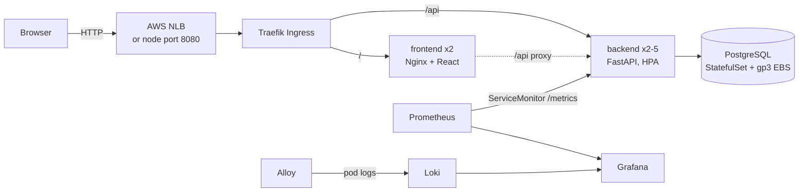
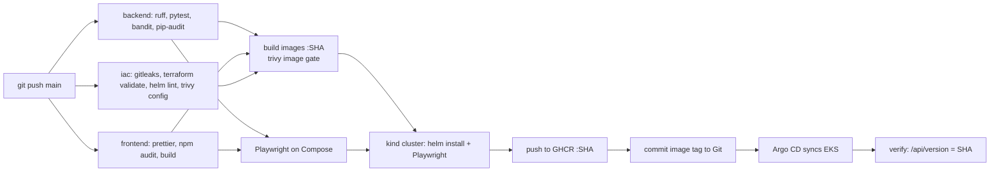

# SeatLock architecture and decisions

## System overview

In the default `nlb` mode the nodes run in private subnets and only the load balancer sits
in the public subnets. In `hostport` mode (for accounts without load balancers, and for the
cheapest demo) the nodes sit in public subnets and Traefik answers on port 8080 of each node (80 is reserved by the EKS Pod Identity agent). One release of the Helm chart owns the application; the Ingress controller
and monitoring stack are separate platform releases installed once by `scripts/eks-bootstrap.sh`.

## Booking correctness

The browser displays availability and a countdown; PostgreSQL decides who owns a seat. Every API replica uses the same database and transaction rules.

1. Acquire a shared event-row lock. Buyers can share it, while an organizer edit waits.
2. Lock all requested seat rows in ascending ID order, avoiding inconsistent multi-seat lock ordering.
3. Recheck event start time and hold expiry after obtaining the locks.
4. Reject the entire request if any seat is booked or actively held. Otherwise insert a hold, assign every seat, and add its audit entry in one transaction.
5. Confirmation locks the hold and its allocated seats, checks expiry/allocation, and records a stable reference. Retrying confirmation returns that reference.
6. Release/cancellation locks the hold and its seats, clears only its current allocation, and commits an audit event with the state change.

~~~mermaid
stateDiagram-v2
    [*] --> Active: atomically acquire seats
    Active --> Confirmed: confirm before expiry
    Active --> Released: release
    Active --> Expired: server time passes expiry
    Expired --> [*]: seats can be reassigned
    Confirmed --> Confirmed: retry returns same reference
    Confirmed --> Cancelled: cancel before event starts
    Cancelled --> Cancelled: retry succeeds
    Released --> Released: retry succeeds
~~~

Expiry is a derived state for an active hold. A worker is unnecessary for inventory correctness: availability and acquisition both check the server timestamp. Old holds/audit records remain as history. A stale holder cannot confirm seats that have been reassigned.

Money is stored in integer paise and snapshotted per hold. The UI shows that snapshot after reservation and preserves fractional rupees. Organizer title/date edits are refused after any reservation; shared event locks close the race between that check and a buyer creating the first hold.

## Delivery pipeline

- **Build once, promote the same bytes.** Each image is built a single time, scanned, saved as
  a workflow artifact, tested in kind, and only then pushed. GHCR receives exactly the image
  that passed every gate, never a rebuild.
- **Commit SHA tags only.** `ghcr.io/<owner>/seatlock-backend:<sha>` maps any running Pod back
  to its source commit. There is no `latest` tag to drift.
- **GitOps: the cluster pulls, CI never pushes.** CI's last step commits the new image tag
  to `helm/seatlock/values-eks.yaml`. Argo CD inside the cluster notices and syncs, so
  GitHub holds no cloud credentials and no kubeconfig at all. The Argo CD AppProject may
  only read this repository and only deploy into the `seatlock` namespace.
- **Ordered, self-healing rollout.** Sync waves create the database first, then run the
  Alembic migration Job as a sync hook, then roll out the app; Argo CD retries a failed sync
  and reverts manual drift (self-heal). A final CI job polls the public `/api/version` until
  it reports the new commit, so a green run means the version is live. Rollback is a
  `git revert` of the tag commit.
- **Pinned supply chain.** Every GitHub Action is pinned to a full commit SHA; Trivy and
  Gitleaks run from digest-pinned images; kind and Helm binaries are checksum-verified.
  Dependabot proposes updates, and each update goes through the full pipeline.

## Infrastructure (Terraform)

| Resource | Choice | Why |
|---|---|---|
| VPC | `10.42.0.0/16`, 2 AZs, 2 public + 2 private subnets | `nlb` mode keeps nodes private and lets load balancers use the public subnets (`kubernetes.io/role/elb` tag) |
| NAT | One shared NAT gateway in `nlb` mode, none in `hostport` mode | Lowest cost for a demo; production would run one per AZ |
| EKS | Managed control plane, API-mode access entries | No `aws-auth` ConfigMap to hand-edit; access is declared in Terraform |
| Nodes | Managed node group, 2 × t3.medium (1 to 3) | Fits app, Ingress and monitoring with headroom |
| Add-ons | CoreDNS, kube-proxy, VPC CNI, metrics-server, Pod Identity agent, EBS CSI | metrics-server feeds the HPA; EBS CSI provisions encrypted gp3 volumes and gets AWS permissions through EKS Pod Identity, so no IAM OIDC provider is needed |
| IAM | Cluster, node and EBS CSI roles only | CI needs no AWS identity, because Argo CD pulls deployments |

Kubernetes itself creates AWS resources Terraform does not track: the NLB for the Ingress (in `nlb` mode)
Service and EBS volumes for PVCs. `scripts/eks-teardown.sh` deletes them through Kubernetes
first, waits for the load balancer to disappear, then runs `terraform destroy` and checks
for leftover volumes. Without this order, VPC deletion stalls and orphaned disks keep billing.

## Runtime and recovery

The frontend uses the container's DNS resolver so replacing an API container does not leave Nginx pointing at an old Docker IP. Startup probes accommodate initialization, readiness checks database/schema access, and liveness checks the process. Pod termination includes a short drain delay for endpoint propagation.

PostgreSQL uses a persistent StatefulSet claim. API pods are disposable. The database remains a single-instance demo deployment, so a DB restart can cause a short outage. A Helm rollback changes application/configuration; it cannot reverse a schema migration. Current migration 0001 is compatible with the recorded local image rollback.

Traefik implements Ingress: on minikube it uses a dedicated IngressClass behind a ClusterIP Service, on EKS it is the default class behind an AWS Network Load Balancer. Prometheus Operator discovers API replicas through ServiceMonitor, Grafana consumes live metrics, and Alloy reads only SeatLock namespace pod logs through scoped RBAC. Loki keeps local filesystem data with 24-hour retention. Request IDs remain log fields rather than Loki labels to avoid excessive label cardinality.

## Security model

| Layer | Control |
|---|---|
| Code | Bandit SAST (medium+ fails), Ruff lint |
| Dependencies | pip-audit and npm audit against lockfiles, Dependabot |
| Secrets | Gitleaks over the full Git history; scanner self-test plants a fake token to prove detection |
| Images | Trivy, fail on any HIGH or CRITICAL (fixed or unfixed); Alpine bases with `apk upgrade` |
| IaC | Trivy misconfiguration scan of Terraform, Helm and Dockerfiles; accepted findings justified in `.trivyignore` |
| Runtime | Non-root UIDs, read-only root filesystem, all capabilities dropped, no privilege escalation, no service-account token mounts |
| Cloud access | No cloud credentials in CI; Argo CD project limited to one repository and one namespace |
| App | HttpOnly SameSite session cookie (hash stored server-side), custom-header + Origin check on mutations, separate organizer token |

Known limits, deliberately out of scope for a demo: guest sessions instead of accounts, no
payments, plain HTTP on the load balancer hostname or node IP (TLS would need a domain and ACM or
cert-manager), a single-instance PostgreSQL where production would use Amazon RDS Multi-AZ,
and Kubernetes Secrets created from a local file where production would use AWS Secrets
Manager with the External Secrets Operator.
